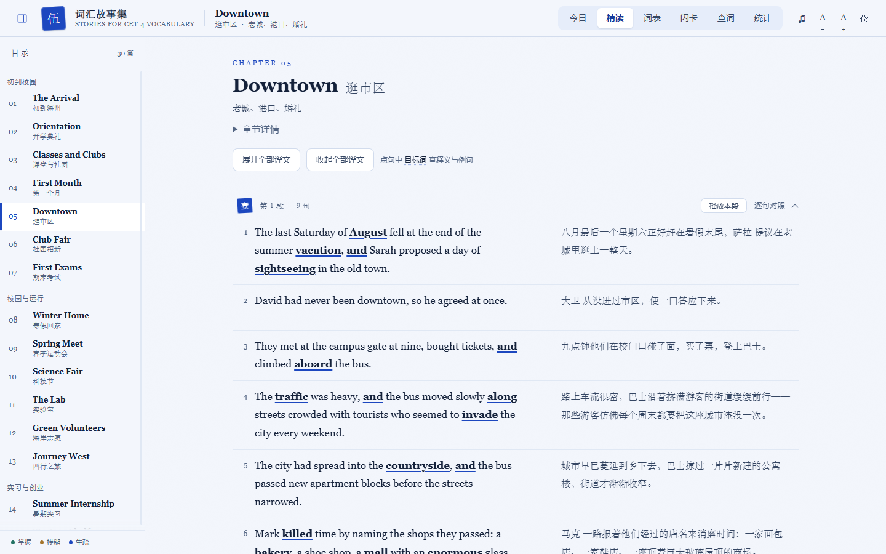
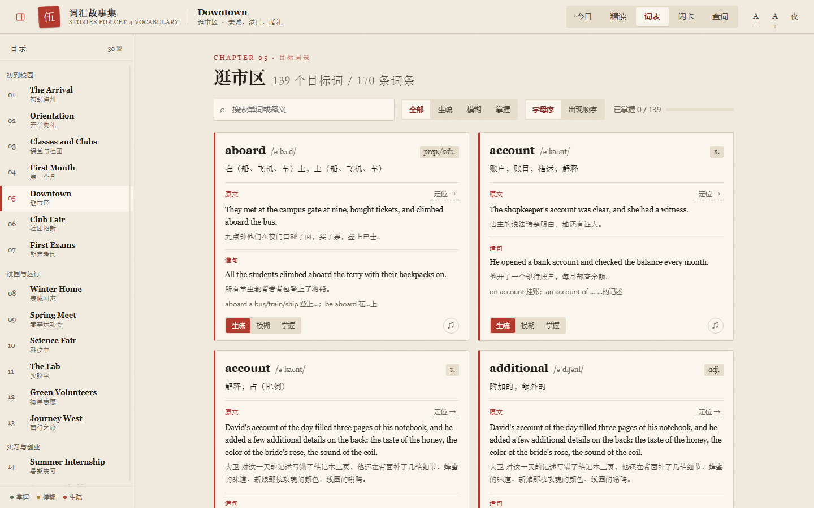
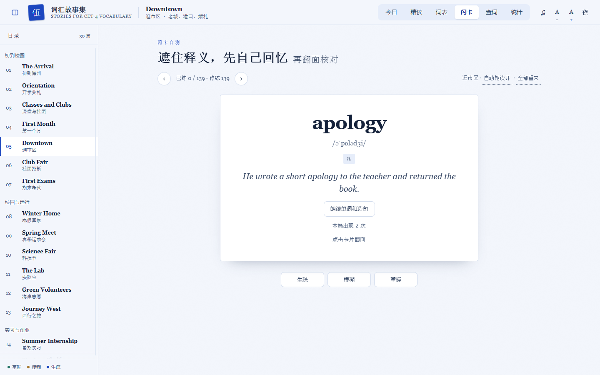

# WordYarn

<p align="center">
  <a href="README.md"></a>
  <a href="README.en.md"></a>
</p>

**Spin 4,154 CET-4 words into one continuous story.**

WordYarn turns China's CET-4 vocabulary syllabus into **30 connected short stories** about a student named David Lin and his four years at Haizhou University. Every word on the syllabus appears in context, and every occurrence is verified by script — then wrapped in a reader that gives you sentence-level translations, example sentences, pronunciation, and flashcards.

[Open the web reader](https://yjwyyds1.github.io/WordYarn/) · [Windows setup](desktop/README.md) · [Android setup](android/README.md)



<p align="center">
  
  
  
  
  
</p>

---

## What's inside

| | |
| --- | --- |
| **30 chapters** | One continuous campus story, 1,400–1,600 words each, 8–10 paragraphs — written to be read, not assembled from a word list. |
| **4,154 syllabus words** | Zero omissions, zero duplicates across the whole series. Every chapter carries 138–139 target words. |
| **3,032 sentence translations** | Sentence-by-sentence English–Chinese alignment for all 30 chapters. |
| **5,061 vocabulary examples** | An original example sentence, translation, and usage note for every word sense. |
| **Web, Windows, and Android** | A static web reader, a Windows desktop app, and an offline Android app with bundled Kokoro speech. |

## Features

### Read · 精读

- **Sentence-by-sentence alignment** — English on the left, Chinese on the right, one sentence per row.
- **Target words underlined in vermilion**; click one for a card with phonetics, part of speech, meaning, the sentence you are reading, an extra example, and pronunciation.
- **Text-to-speech** — read a sentence, or let a paragraph play with karaoke-style word highlighting.
- **Continuous or aligned mode** — read a paragraph like a book, or expand it into two columns.

### Vocabulary · 词表



- 139 target words per chapter, each with phonetics, meaning, its original sentence, and a transferable example sentence.
- Search by word or Chinese meaning; filter by mastery (new / fuzzy / known); sort alphabetically or by order of appearance.
- “Locate →” jumps back to the exact sentence in the reading view.

### Flashcards · 闪卡



- See the word first, recall the meaning, then flip.
- Rate each card **new / fuzzy / known**; weaker words come back sooner.
- Arrow keys to navigate, `1` `2` `3` to rate.

### Study mode (optional)

A small C++ service (Drogon + SQLite) adds a **Today** page that resumes your last paragraph, reviews words that are due, and keeps answer history. A site-wide dictionary searches both English and Chinese meanings.

## Quick start

### Android offline app

Requires Android 8.0 or later. The APK bundles all 30 stories, translations, vocabulary lists, and flashcards. Reading position, vocabulary mastery, and review history stay on the phone.

The bundled **Kokoro English voice** reads stories, words, examples, and custom English sentences offline. See the [Android installation and build guide](android/README.md) (Chinese).

### 1. Static reader — no install, no network

```bash
# from the repository root
node web/tools/serve.mjs 8848
# open http://127.0.0.1:8848/index.html
```

You can also just open `web/site/index.html` directly in Chrome or Edge — all data is loaded from local files, so `file://` works.

Deep links:

| URL | Opens |
| --- | --- |
| `index.html#ch05/read` | Chapter 5 · reading |
| `index.html#ch05/vocab` | Chapter 5 · word list |
| `index.html#ch05/cards` | Chapter 5 · flashcards |

### 2. Study mode with a database

On Windows, double-click `Open-CET4.cmd` or run the WSL web launcher:

```powershell
powershell -ExecutionPolicy Bypass -File web/tools/start-study.ps1
# open http://127.0.0.1:8848/
```

Study records are stored in `var/study.sqlite`. See [web/backend/README.md](web/backend/README.md) for configuration, API, and tests.

### 3. Windows desktop

Open `desktop/dist/WordYarn.exe` from the built package. The desktop app runs without WSL and imports the web database on first launch. See [desktop/README.md](desktop/README.md) for use and build details.

### Static site deployment configuration

The repository includes a GitHub Pages workflow. Push to `main`, then set **Settings → Pages → Source** to **GitHub Actions**; the `web/site/` folder is deployed as-is. All paths are relative, so it also works under a project subpath such as `https://<user>.github.io/wordyarn/`.

## Repository layout

```
.
├─ web/                        Web app, content, and tools
│  ├─ 词汇故事集/              30 chapters (Markdown: story + target-word table)
│  ├─ 四级考纲词汇总表.md      Full 4,154-word syllabus list with chapter index
│  ├─ content/                 Hand-written translations and vocabulary examples
│  │  ├─ chNN.sentences.json   Sentence-level Chinese translation
│  │  └─ chNN.vocab.json       Phonetics and example sentences
│  ├─ site/                    Static reader (index.html, assets, generated data)
│  ├─ backend/                 Optional C++ study server (Drogon + SQLite)
│  ├─ tools/                   Build, validate, serve, and screenshot scripts
│  └─ plan/                    Word allocation and coverage-check scripts
├─ desktop/                    Native Windows app and packaging
├─ android/                    Offline Android app, tests, and APK build script
├─ var/                        Local web database (ignored by Git)
├─ docs/assets/                README screenshots
└─ .github/workflows/          GitHub Pages deployment
```

## How the vocabulary coverage is guaranteed

The master list is the single source of truth. Words are distributed round-robin across 30 chapters, then each chapter is checked against its target list with `web/plan/check.py`, which understands regular inflections (`-s/-es/-ed/-ing`, y→ies, consonant doubling, `(s)` variants) and slash forms such as `analyze/analyse`.

```bash
python web/plan/check.py 7        # chapter 7: every target word must appear
python web/plan/style_check.py    # length, paragraph count, formatting rules
```

Current status: **30/30 chapters, 0 missing words**.

## Rebuilding the site data

After editing a chapter or a translation:

```bash
node web/tools/validate_content.mjs chNN   # translation alignment must pass
node web/tools/build_site_data.mjs         # regenerate web/site/data/chNN.js
```

The Windows and Android builds copy the current assets from `web/site/` when packaged.

## Roadmap

- [x] 30 chapters · 4,154 words · full sentence translations
- [x] Static reader with read / vocabulary / flashcards views
- [x] Local study server with spaced repetition and history
- [x] Static web reader hosted on GitHub Pages
- [x] Windows desktop app
- [x] Offline Android app with bundled Kokoro speech
- [ ] Cross-device progress sync
- [ ] Additional exam word lists (CET-6, postgraduate, IELTS)

## Notes and limits

- Web pronunciation depends on browser voices. The Windows app can use local Windows speech, and the Android app uses its bundled offline Kokoro engine.
- The static reader uses browser storage, the database-backed study mode uses SQLite, and Android keeps progress in the app. Progress does not sync automatically across devices.
- The stories are original writing; the syllabus list follows a common published version of the CET-4 outline and may differ slightly from other editions.

## 中文说明

详细的中文使用说明见 [README.md](README.md)；网站本身的说明见 [web/site/README.md](web/site/README.md)。
