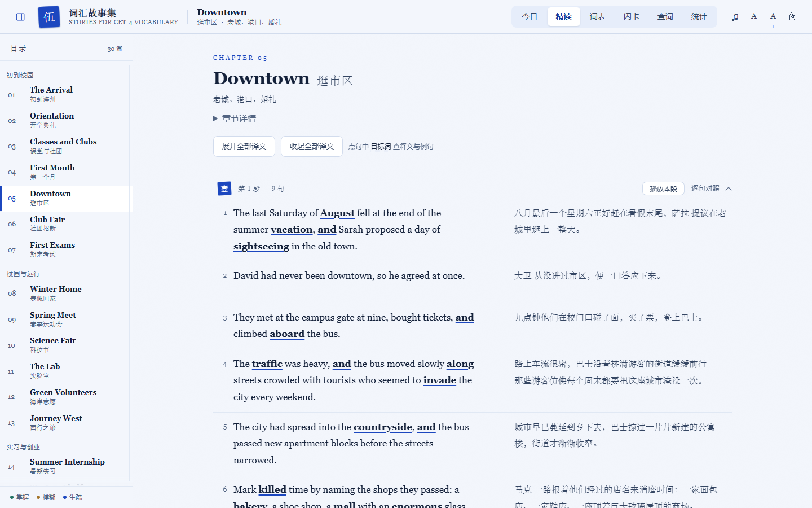
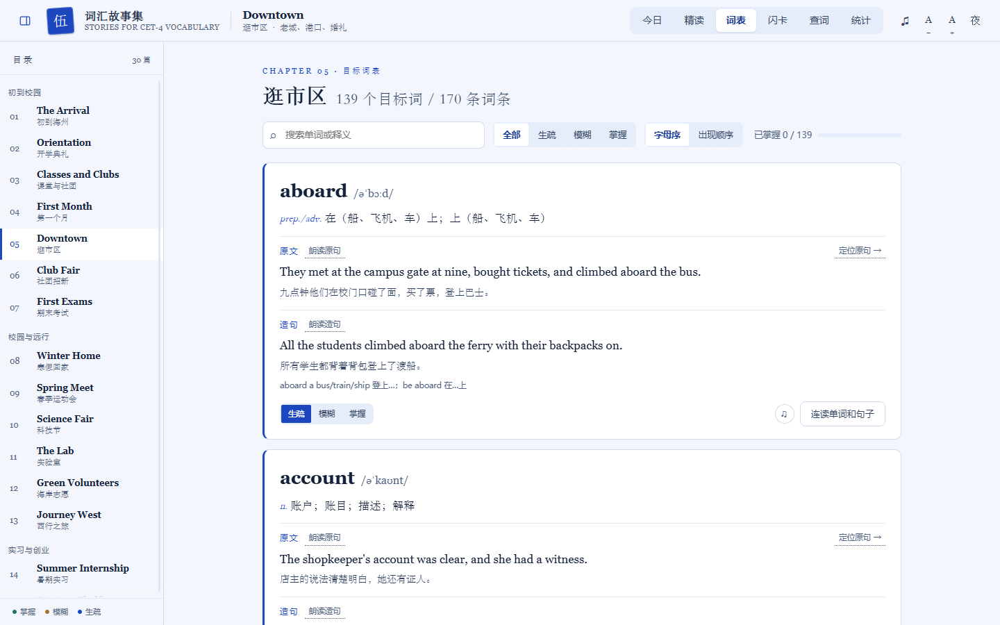
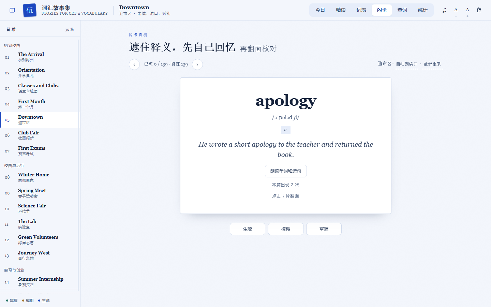

# WordYarn · 四级词汇故事集

<p align="center">
  <a href="README.md"></a>
  <a href="README.en.md"></a>
</p>

> 把《大学英语四级考试大纲》的 **4,154 个核心词**编进 **30 篇连续故事**。用网页版、Windows 桌面版或 Android 离线版精读、查词和复习。

[打开在线网页版](https://yjwyyds1.github.io/WordYarn/) · [Windows 使用与构建](desktop/README.md) · [Android 安装与构建](android/README.md)



<p align="center">
  
  
  
  
  
</p>

---

## 一、这是什么

以大学生**林远（David）**为主角，室友 Mark、好友 Sarah 贯穿始终，从大一入学写到毕业后的第一年。30 篇文章各自独立成篇、连起来又是一条完整的时间线：

| 阶段 | 篇目 | 内容 |
| --- | --- | --- |
| 大一 | 01–07 | 初到海州、开学典礼、课堂与社团、第一个月、逛市区、社团招新、期末考试 |
| 大二 | 08–13 | 寒假回家、春季运动会、科技节、实验室、海岸志愿、西行之旅 |
| 大三 | 14–20 | 暑期实习、创业·书架、创业·转型、谣言事件、校报编辑部、健康与体检、诈骗风波 |
| 大四 | 21–28 | 安全课堂、春节文化周、博物馆、讲解员、爱与成长、回乡、论文与求职、毕业 |
| 毕业后 | 29–30 | 工作的第一年、周年与终章 |

每篇正文 **1,400–1,600 词、8–10 个自然段**，纯叙事散文；目标词自然嵌在情节里，靠上下文理解，而不是词条堆砌。

## 二、三个视图

### 1. 精读

- 逐句左右对照：左边英文原句，右边中文译文。
- 两种阅读方式：整段连续阅读，或展开成逐句对照。
- 句中目标词带蓝色下划线，点一下弹出词条卡：音标、词性、释义、原文例句、拓展例句、朗读、掌握度。
- 朗读支持单句和整段，整段朗读时逐词高亮。
- 顶部可一键展开/收起全部译文。

### 2. 词表



- 每篇 138–139 个目标词，每词一张卡片：音标、词性、释义、原文句子及译文、拓展例句与用法提示。
- 支持按单词或中文释义搜索，按掌握度筛选，按字母序或出现顺序排列。
- 「定位 →」跳回精读视图并高亮原句。

### 3. 闪卡



- 正面只显示单词和音标，先回忆再翻面。
- 按「生疏 / 模糊 / 掌握」评分，掌握度低的词优先出现。
- 键盘 `←` `→` 翻卡，`1` `2` `3` 评分。

### 4. 今日 / 查词

C++ 学习服务会把阅读位置、复习到期时间和答题历史存进 SQLite。「今日」可以继续上次读到的段落、复习到期词；「查词」支持中英文搜索并定位原句，静态版也可以查词。

## 三、怎么用

### Android 离线版

支持 Android 8.0 及以上。30 篇故事、译文、词表和闪卡随 APK 打包，断网也能使用。阅读位置、词汇掌握度和答题历史保存在当前手机。

内置 **KittenTTS 英语音色**，默认使用与 Windows 版相同的 0 号男声。可离线朗读正文、单词、例句，也可在「朗读设置 → 试读英文」中输入新句子。APK 的安装与本地构建步骤见 [安卓版说明](android/README.md)。

### 方式 A：静态站点（零安装、离线可用）

```bash
# 在仓库根目录
node web/tools/serve.mjs 8848
# 打开 http://127.0.0.1:8848/index.html
```

也可以直接双击 `web/site/index.html`，用 Chrome / Edge 打开。所有数据都是本地文件，不联网也能用。

深链接：

| 链接 | 打开什么 |
| --- | --- |
| `index.html#ch05/read` | 第 5 章 · 精读 |
| `index.html#ch05/vocab` | 第 5 章 · 词表 |
| `index.html#ch05/cards` | 第 5 章 · 闪卡 |

### 方式 B：带数据库的学习模式

Windows 上双击 `Open-CET4.cmd`，或运行以下命令。这个网页版入口使用 WSL。

```powershell
powershell -ExecutionPolicy Bypass -File web/tools/start-study.ps1
# 打开 http://127.0.0.1:8848/
```

学习记录保存在 `var/study.sqlite`。首次配置、接口与测试见 [web/backend/README.md](web/backend/README.md)。

### 方式 C：Windows 桌面版

双击 `desktop/dist/WordYarn.exe` 打开独立窗口。桌面版无需 WSL，首次启动会从网页版数据库导入学习记录，之后独立保存。使用与构建说明见 [desktop/README.md](desktop/README.md)。

### 静态站点的部署配置

仓库里已带一个 Pages 工作流。推送到 `main` 后，在 **Settings → Pages → Source** 选择 **GitHub Actions**，`web/site/` 目录会原样发布。页面全部使用相对路径，因此项目子路径（如 `https://<用户名>.github.io/wordyarn/`）也能正常访问。

## 四、目录结构

```
D:\CET4
├─ web/                    站点、内容与工具
│  ├─ 词汇故事集/           30 篇故事的 Markdown（正文 + 目标词表）
│  ├─ 四级考纲词汇总表.md   4,154 词总表，含词性、释义和「所在篇目」
│  ├─ content/             人工撰写的逐句译文与词汇例句
│  │  ├─ chNN.sentences.json  第 NN 章逐句中文译文
│  │  └─ chNN.vocab.json      第 NN 章音标与例句
│  ├─ site/                静态网站（HTML / CSS / JS / 生成的数据）
│  ├─ backend/             C++ 学习服务（Drogon + SQLite）
│  ├─ tools/               切句、构建、校验、本地服务器、截图脚本
│  └─ plan/                词表拆分与逐词校验脚本
├─ desktop/                原生 Windows 桌面版和本地打包脚本
├─ android/                Android 离线版源码、测试和 APK 构建脚本
├─ var/                    本机网页版 SQLite 数据（不进入 Git）
├─ docs/assets/            README 截图
└─ .github/workflows/      GitHub Pages 自动部署
```

## 五、词汇覆盖是怎么保证的

总词表是唯一数据源。全部词条按轮转方式分配到 30 篇，每篇再用 `web/plan/check.py` 逐个核对目标词是否真的出现在正文中。校验器识别常见词形变化（`-s/-es/-ed/-ing`、y→ies、辅音双写、`(s)` 变体）以及 `analyze/analyse` 这类斜杠形式。

```bash
python web/plan/check.py 7        # 校验第 7 篇，必须 0 missing
python web/plan/style_check.py    # 检查字数、段数与格式
```

当前状态：**30/30 篇通过，0 个遗漏词**。

## 六、修改内容后怎么重建

改完某一章的正文或译文后：

```bash
node web/tools/validate_content.mjs chNN   # 译文与原文必须逐句对齐
node web/tools/build_site_data.mjs         # 重新生成 web/site/data/chNN.js
```

改单词例句时，编辑 `web/content/chNN.vocab.json` 里对应词的例句。Windows 和 Android 版都在打包时复制 `web/site/` 的资源。

## 七、路线图

- [x] 30 篇故事 · 4,154 词 · 全量逐句译文
- [x] 静态站点：精读 / 词表 / 闪卡
- [x] 本地学习服务：间隔复习与答题历史
- [x] GitHub Pages 在线静态版
- [x] Windows 单机桌面版
- [x] Android 离线版与内置 KittenTTS 朗读
- [ ] 跨设备学习记录同步
- [ ] 扩展到六级、考研、雅思等词表

## 八、已知限制

- 网页版朗读取决于浏览器提供的英语音色。Windows 和 Android 版内置同一套 KittenTTS 离线音色。
- 静态站点的学习记录保存在浏览器本地存储中，带数据库的学习模式使用 SQLite。Android 版将记录保存在应用内，三端目前没有自动同步。
- 故事为原创；考纲词表依据常见公开版本整理，不同版本之间可能有个别出入。

## 九、更多说明

- 网站细节：[web/site/README.md](web/site/README.md)
- 学习服务：[web/backend/README.md](web/backend/README.md)
- English README: [README.en.md](README.en.md)
